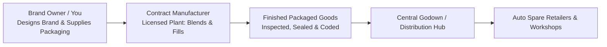
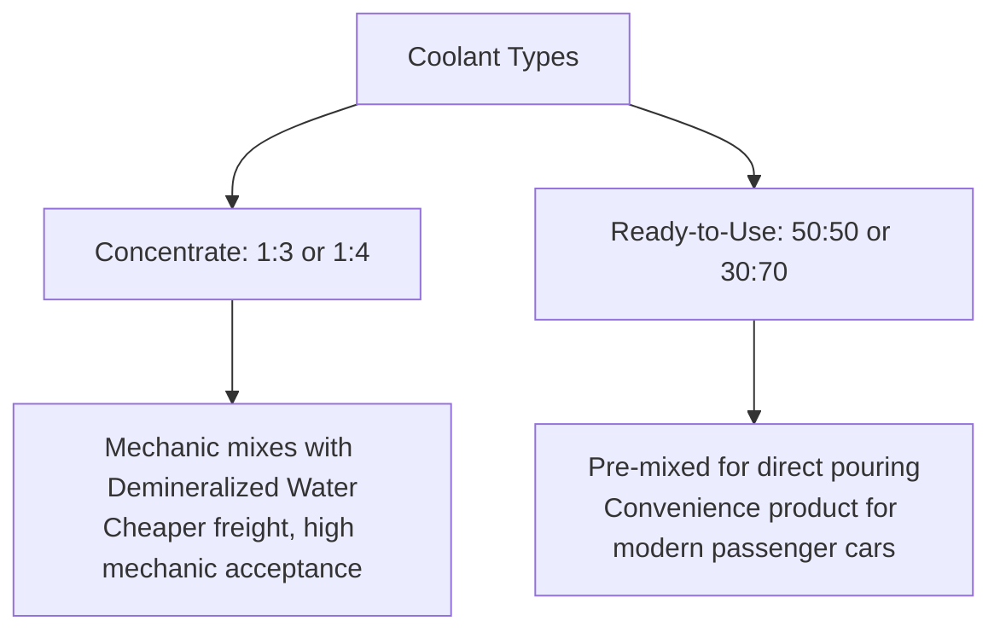
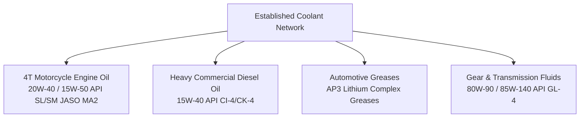
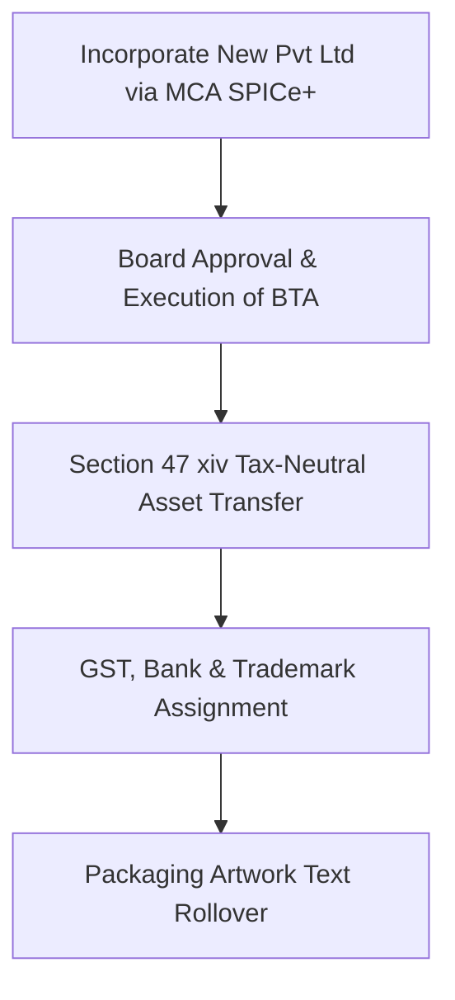

# Project Handover Blueprint: Automotive Fluid & Lubricant Brand
**Operating Model:** Third-Party Contract Manufacturing / White-Label Marketer  
**Launch Focus:** Engine Radiator Coolant (Phase 1) $\rightarrow$ Automotive Lubricants & Oils (Phase 2)  
**Corporate Structure:** Sole Proprietorship $\rightarrow$ Private Limited Company (Pvt Ltd)

---

## 1. Executive Summary & Operating Model

This venture operates on the **Asset-Light Marketer (Merchant Exporter/Trader)** framework. Rather than investing capital in heavy chemical blending kettles, storage vats, and hazardous emission compliance, the business focuses 100% of its resources on **brand equity, packaging design, quality assurance, and garage/dealer distribution**.



### Strategic Advantages of This Model
* **Zero Environmental/Hazardous Permits for You:** All chemical processing and effluent management are handled under the manufacturer's existing State Pollution Control Board (SPCB) consents.
* **Low Initial Capital Requirement:** Eliminates ₹40L–₹1.5Cr machinery capital expenditure; initial funds go directly into working capital, inventory, and marketing.
* **Rapid Speed-to-Market:** Product can be on shelves within 30 to 45 days.

---

## 2. Legal, Statutory & Compliance Framework

### Phase 1: Sole Proprietorship Setup

| Registration | Purpose & Detail | Authority / Portal |
| :--- | :--- | :--- |
| **Proprietor PAN & Aadhaar** | Foundational KYC for all business bank accounts. | NSDL / UIDAI |
| **GST Registration** | Category: Wholesale Trading of Petroleum & Automotive Fluids.<br>**HSN 3820** (Anti-freezing preparations and prepared de-icing fluids / Coolants).<br>**HSN 2710** (Lubricating oils and greases for Phase 2). | GST Portal |
| **Udyam (MSME)** | Micro-Enterprise registration. Unlocks priority bank lending, lower trademark filing fees, and MSME Samadhaan delayed-payment protections. | Udyam Registration Portal |
| **Shop & Establishment** | Local municipal registration for commercial office/storage warehouse. | Local Municipal Body |
| **Current Bank Account** | In the trade name of the proprietorship with net-banking and auto-debit facility. | Any Commercial Bank |

### Brand Intellectual Property (IP)

* **Trademark Filing (Nice Classification):**
  * **Class 1:** Anti-freeze, engine coolants, chemical additives for motor oils.
  * **Class 4:** Industrial oils, lubricants, motor oils, engine oils, greases.
  * *Execution Note:* File both classes under your individual personal name immediately. This allows you to license or assign the trademarks to your future Private Limited company seamlessly without third-party dispute.

### Packaging Regulatory Mandate: Legal Metrology Act

Under Rule 27 of the **Legal Metrology (Packaged Commodities) Rules**, the packaging artwork must contain the following statutory display:

```
┌────────────────────────────────────────────────────────────────────────┐
│  PRODUCT: Heavy Duty Radiator Coolant (Concentrate 1:3 / RTU)          │
│  NET VOLUME: 1 Litre (at 29.5°C)                                       │
│                                                                        │
│  MANUFACTURED BY:                                                      │
│  [Name of Contract Manufacturer's Entity]                              │
│  [Factory License Number / Plant Address, State, PIN]                  │
│                                                                        │
│  PACKED & MARKETED BY:                                                 │
│  [Your Sole Proprietorship Brand / Trade Name]                         │
│  [Your Registered Office / Godown Address, State, PIN]                 │
│                                                                        │
│  CUSTOMER CARE EXECUTIVE:                                              │
│  Toll-Free / Phone: +91-XXXXXXXXXX | Email: support@yourbrand.com      │
│  Address: Same as Marketed By                                          │
│                                                                        │
│  MRP: ₹ [Inclusive of all taxes]                                       │
│  BATCH NO. & PACKING DATE: [Machine printed on neck/carton]            │
└────────────────────────────────────────────────────────────────────────┘
```

---

## 3. Product Formulation & Quality Standards (Coolant)

Coolants are critical engine safety fluids. Supplying sub-standard colored water ruins engine water pumps and radiators, leading to garage boycotts. The product must strictly meet recognized automotive benchmarks.

### Technical Specifications



1. **Active Base:** Monoethylene Glycol (MEG).
2. **Inhibitor Chemistry:** Organic Acid Technology (OAT) with anti-corrosion additives to protect cast iron, aluminum, brass, and solder.
3. **Target Standard Benchmarks:**
   * **IS 5759:** Bureau of Indian Standards specification for automotive engine coolants.
   * **JIS K 2234:** Japanese Industrial Standard for engine antifreeze/coolants.
4. **Color Portfolio:**
   * **Fluorescent Green:** Dominates commercial vehicles, tractors, and older cars.
   * **Red / Pink:** Industry standard for modern multi-valve aluminum engines (Tata, Maruti, Hyundai, Toyota).

> [!IMPORTANT]
> Always mandate a **Certificate of Analysis (COA)** from the manufacturer for every delivered batch verifying:
> * Glycol percentage (by refractive index / specific gravity).
> * Equilibrium Boiling Point (> 155°C for pure concentrate; > 108°C for diluted).
> * pH Level (strictly between 7.5 and 9.0 to prevent acidic radiator corrosion).

---

## 4. Packaging Sourcing & Production Pipeline

### Sourcing Matrix

| Item | Specification | Sourcing Source | Minimum Order Qty (MOQ) |
| :--- | :--- | :--- | :--- |
| **Bottles** | 1-Litre & 3-Litre HDPE standard blow-molded bottles (translucent with level strip or opaque white/silver). | Open-mold bottle suppliers (Delhi NCR, Ahmedabad, Daman, or local industrial area). | 1,000 – 3,000 units |
| **Caps** | Tamper-evident pull-ring cap with induction heat-seal foil liner (wad). | Molded cap vendors. | Matching bottle count |
| **Labels** | Polypropylene (BOPP) / Vinyl self-adhesive roll stickers with high-gloss UV lamination (oil & moisture resistant). | Industrial label converters / flexo printers. | 2,000 – 5,000 pcs |
| **Outer Box** | 5-ply kraft corrugated cartons holding 12 or 20 one-litre bottles, printed with your brand logo and HSN details. | Local corrugated box manufacturers. | 200 – 500 boxes |

### Order & Delivery Execution Pipeline

```mermaid
sequenceDiagram
    autonumber
    actor You as Brand Owner
    participant Pack as Bottle & Label Vendors
    participant Mfg as Contract Manufacturer
    participant Hub as Your Distribution Godown

    You->>Pack: Order branded bottles, labels & caps
    Pack-->>Mfg: Ship empty packaging materials via Delivery Challan
    You->>Mfg: Issue Purchase Order for Coolant Formulation
    Mfg->>Mfg: Blend Coolant, Run Quality Lab Check & Issue COA
    Mfg->>Mfg: Fill, Induction Seal, Crimp Cap, Batch Code & Box
    Mfg-->>Hub: Dispatch finished master cartons with GST Tax Invoice
    Hub->>You: Stock in inventory; ready for market distribution
```

---

## 5. Unit Economics & Pricing Model (1-Litre Concentrate)

The following financial blueprint represents current market averages for high-grade MEG OAT coolants:

### Landed Cost Breakdown (Cost of Goods Sold - COGS)

| Component | Cost per Unit (₹) |
| :--- | :--- |
| Coolant Formulation & Factory Filling Job Work | ₹48.00 – ₹62.00 |
| HDPE 1L Bottle + Induction Cap + Liner | ₹15.00 – ₹18.00 |
| Metallic / High-Gloss Front & Back Label | ₹3.50 – ₹5.00 |
| Corrugated Master Carton (Share per bottle) | ₹3.00 – ₹4.50 |
| Inbound Freight & Handling to Warehouse | ₹2.50 – ₹4.00 |
| **Total Landed Unit Cost (Ex-Warehouse)** | **₹72.00 – ₹93.50** |

### Commercial Pricing Waterfall

```
Cost to You:         ₹85.00
                      │  + 41% Brand Mark-up (₹35.00)
Direct to Garage:    ₹120.00 – ₹140.00
                      │  + 85% Garage Mark-up (₹110.00)
Consumer MRP:        ₹230.00 – ₹260.00
```

* **Your Margin:** ₹35 – ₹50 per bottle (~35% to 45% gross margin).
* **Retailer / Garage Margin:** ₹90 – ₹120 per bottle (~70% to 90% return). This high margin structure provides mechanics with the incentive to actively push your product over saturated Tier-1 brands.

---

## 6. Contract Manufacturing (Third-Party) Agreement

Before dispatching packaging to any manufacturer, sign a formal **Third-Party Manufacturing & Supply Agreement**. Ensure the following non-negotiable clauses are included:

1. **Defective Batch & Leakage Rejection:** The manufacturer must bear the replacement cost of both fluid and packaging materials if any batch fails agreed density/boiling standards, or leaks due to faulty induction sealing.
2. **Intellectual Property Protection:** Explicit covenant that the manufacturer acquires no ownership rights over your brand name, trade dress, labels, or distribution trade secrets.
3. **Non-Disclosure & Non-Compete:** The manufacturer shall not use your custom packaging to supply other clients, nor directly contact dealers operating within your designated sales territory.
4. **Delivery Lead-Time & Escalation:** Turnaround time for filled goods from receipt of packaging materials must be capped (standard is 7 to 14 days).

---

## 7. Strategic Expansion to Oils & Lubricants (Phase 2)

Once your brand presence and mechanic trust are established via coolant sales, introduce core high-velocity lubricant lines through the same manufacturing partner:



---

## 8. Conversion Protocol: Sole Proprietorship to Pvt Ltd

When annual revenues reach the ₹40 Lakh – ₹1 Crore threshold, convert to a **Private Limited Company** to enable institutional tenders, distributor credit lines, and bank working-capital facilities.

### Step-by-Step Conversion Execution



1. **Entity Incorporation:**
   * Apply for Director Identification Numbers (DIN) and Digital Signature Certificates (DSC) for at least 2 directors.
   * Reserve corporate name on the MCA SPICe+ Part A portal (e.g., `[BrandName] Lubricants Private Limited`).
   * Draft Articles of Association (AoA) and Memorandum of Association (MoA) incorporating lubricant and automotive fluid trade objects.
2. **Business Transfer Agreement (BTA) / Slump Sale:**
   * Execute an agreement between you (as Sole Proprietor) and the newly formed Private Limited Company.
   * The new company absorbs all goodwill, existing dealer accounts, unpaid receivables, and warehouse stock.
3. **Capital Gains Tax Exemption (Section 47(xiv) of Income Tax Act):**
   * *Requirement 1:* All assets and liabilities of the sole proprietorship transfer to the company.
   * *Requirement 2:* The sole proprietor holds not less than 50% of the total voting power in the company for at least 5 years.
   * *Requirement 3:* No monetary consideration is paid other than the allotment of shares in the company.
4. **Transitioning Operations:**
   * **GST:** Apply for a fresh GST registration under the Pvt Ltd PAN; transfer unutilized input tax credit (ITC) via **Form GST ITC-02**.
   * **Trademark:** Execute a simple Trademark Assignment Deed (Form TM-P) transferring marks from individual ownership to the corporate entity.
   * **Packaging:** Update the `"Marketed by:"` text on the next batch print run to reference the new Private Limited entity. Existing pre-printed stock can be exhausted legally under a transition window.

---

## 9. 30-Day Launch Checklist

```
Week 1: Foundations
[ ] Finalize Brand Name & Run Trademark Clearance Search in Classes 1 & 4.
[ ] File Online Trademark Application under your personal name.
[ ] Obtain Sole Proprietorship GST and Udyam Registrations.
[ ] Open Current Bank Account with bank of choice.

Week 2: Sourcing & Formulation
[ ] Audit 2-3 local ISO-certified lubricant & fluid contract manufacturers.
[ ] Inspect manufacturer's lab equipment (Refractometer, Hydrometer, pH meter).
[ ] Finalize Supply & Quality Assurance Agreement.
[ ] Select standard 1L & 3L HDPE bottle shapes from bottle supplier catalog.

Week 3: Artwork & Production
[ ] Design label artwork compliant with Legal Metrology Rule 27.
[ ] Print initial batch of roll-feed BOPP/Vinyl stickers.
[ ] Procure bottles, induction-lined caps, and 5-ply printed master cartons.
[ ] Send packaging materials to the manufacturer along with formal PO.

Week 4: Launch & Distribution
[ ] Receive finished goods with Certificate of Analysis (COA) at warehouse.
[ ] Establish initial route-to-market targeting 25-50 independent auto repair workshops.
[ ] Equip sales representatives with product sample kits and demonstration hydrometers.
```
