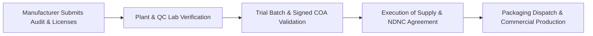

# SHALI KUL™ — Third-Party Contract Manufacturer Compliance & Technical Audit Checklist

**Document Type:** Contract Manufacturer Pre-Qualification & Batch Audit Checklist  
**Issued By:** SHALI KUL™ (Brand Owner / Marketer)  
**Target Recipient:** Prospective Chemical Blenders, Fluid Formulators & Bottling Plants  
**Product Line:** Heavy-Duty Radiator Coolant (Concentrate 1:3 & RTU 50:50) $\rightarrow$ Automotive Lubricants (Phase 2)  
**Date of Issuance:** 2026-10-29  

---

## 1. Executive Instructions for Prospective Manufacturers

This document defines the **statutory, technical, laboratory, and operational standards** required to qualify as an approved contract manufacturing partner for **SHALI KUL™**. 

To be onboarded, the manufacturing plant must complete this audit form, provide verified documentary proofs, and agree to the mandatory quality covenants prior to the issuance of Purchase Orders (PO) or packaging dispatches.



---

## 2. Manufacturer Audit Checklist Matrix

### Section 1: Statutory Licenses & Environmental Compliances (Mandatory Gate)

> [!IMPORTANT]
> The manufacturer must hold active, valid consents in its own registered entity name. All chemical blending, hazardous effluent handling, and industrial safety liabilities remain 100% under the manufacturer’s statutory purview.

| # | Statutory Document / License | Regulatory Authority | Verification Requirement & Proof to Attach | Status |
| :-: | :--- | :--- | :--- | :-: |
| **1.1** | **Factory License** | State Directorate of Factories (Factories Act, 1948) | Valid license for chemical/fluid blending and bottling operations with approved plant layout. | `[ ] Verified`<br>`[ ] Pending` |
| **1.2** | **SPCB Consent to Operate (CTO) — Water** | State Pollution Control Board (Water Act, 1974) | Valid CTO for industrial effluent discharge and Zero Liquid Discharge (ZLD) / ETP operation. | `[ ] Verified`<br>`[ ] Pending` |
| **1.3** | **SPCB Consent to Operate (CTO) — Air** | State Pollution Control Board (Air Act, 1981) | Valid consent covering emissions from boilers, chemical storage, and blending vessels. | `[ ] Verified`<br>`[ ] Pending` |
| **1.4** | **Hazardous Waste Management Authorization** | State Pollution Control Board (HWM Rules, 2016) | Valid authorization for handling, storage, and disposal of hazardous waste (glycols, solvents, sludge). | `[ ] Verified`<br>`[ ] Pending` |
| **1.5** | **Industrial Fire Safety NOC** | State Fire Services Department | Valid Fire NOC for industrial chemical storage and packaging godown. | `[ ] Verified`<br>`[ ] Pending` |
| **1.6** | **GSTIN & PAN Registration** | Commercial Tax Department / Income Tax | Active GST certificate showing Job Work / Chemical Manufacturing classifications. | `[ ] Verified`<br>`[ ] Pending` |
| **1.7** | **Quality Certifications (Optional)** | Certification Bodies | • ISO 9001:2015 (Quality Management)<br>• IATF 16949 (Automotive Quality Standards)<br>• Active BIS License for IS 5759 (if held). | `[ ] Verified`<br>`[ ] N/A` |

---

### Section 2: Plant Infrastructure & Blending Equipment Capabilities

| # | Equipment / Infrastructure | Required Technical Specification | Plant Status & Capacity |
| :-: | :--- | :--- | :-: |
| **2.1** | **Demineralized (DM) Water Plant** | Reverse Osmosis (RO) + Demineralization unit producing water with:<br>• Conductivity: **< 5 µS/cm**<br>• Total Dissolved Solids (TDS): **< 10 ppm**<br>• Hardness: **0 ppm** *(Strictly zero tap water usage).* | `[ ] Meets Spec`<br>`[ ] Needs Audit` |
| **2.2** | **Chemical Blending Kettles** | Stainless Steel (**SS304 or SS316**) closed mixing vessels with mechanical variable-speed agitators to ensure homogenous dissolution of additives, corrosion inhibitors, and dyes. | `[ ] SS304/SS316`<br>`[ ] Other (Specify)` |
| **2.3** | **Daily Blending & Filling Capacity** | Minimum guaranteed processing capacity of **1,000 to 3,000 Litres/day** with scalable surge capacity for peak seasonal runs. | `[ ] Capacity: _____ L/day` |
| **2.4** | **Packaging Storage Godown** | Dedicated, clean, moisture-free indoor warehouse space for safe storage of client-supplied empty HDPE bottles, caps, stickers, and corrugated cartons. | `[ ] Verified`<br>`[ ] Inadequate` |

---

### Section 3: In-House Quality Control (QC) Laboratory & Instrumentation

The plant must operate an **in-house laboratory** equipped with calibrated instruments capable of testing and certifying every batch before release:

| # | Testing Instrument | Target Benchmark & Parameter Tested | Calibration Status |
| :-: | :--- | :--- | :-: |
| **3.1** | **Optical / Digital Refractometer** | Measures Monoethylene Glycol (MEG) % and Specific Gravity (**1.110 to 1.125** at 20°C for pure concentrate). | `[ ] Calibrated`<br>`[ ] Pending` |
| **3.2** | **Equilibrium Reflux Boiling Point Apparatus** | ASTM D1120 / IS 5759 apparatus testing boiling point:<br>• Pure Concentrate: **> 155°C**<br>• Diluted (1:3 with DM Water): **> 108°C** | `[ ] Available`<br>`[ ] Out-Sourced` |
| **3.3** | **Digital pH Meter** | Two-point calibrated meter (pH 7.0 & 10.0 buffers) verifying fluid pH strictly between **7.5 and 9.0** (prevents radiator acidity). | `[ ] Calibrated`<br>`[ ] Pending` |
| **3.4** | **Corrosion & Foam Test Bench** | Glassware corrosion test bench (ASTM D1384) to verify anti-corrosion protection on Aluminum, Copper, Brass, Cast Iron, and Solder; foam break time **< 3 seconds**. | `[ ] Available`<br>`[ ] Certified by Lab` |

---

### Section 4: Formulation Chemistry & Raw Material Authenticity

```
Active Ingredient:        Monoethylene Glycol (MEG) — Virgin Grade ONLY (Strictly 0% Recycled MEG)
Corrosion Inhibitors:     Organic Acid Technology (OAT) Carboxylates + Tolyltriazole (Copper/Brass protection)
Exclusions (Mandatory):   100% Silicate-Free · Phosphate-Free · Borate-Free · Nitrate/Nitrite-Free · Amine-Free
Color Consistency:        Fluorescent Green & Red/Pink — High-stability dyes (Zero fading under UV light)
```

* **Anti-Sludge Warranty:** Formulation must maintain full stability and zero precipitation when exposed to moderately hard water (up to 200 ppm hardness) to prevent field clogging.
* **Batch COA Requirement:** A signed **Certificate of Analysis (COA)** must accompany every delivery challan, stating tested Glycol %, Specific Gravity, pH, Boiling Point, and Foam Break Time.
* **Retained Sample Protocol:** Manufacturer must retain a **500 mL sealed reference sample** from every batch for **24 months** to resolve any market inquiries.

---

### Section 5: Bottling, Sealing & Packaging Integrity Standards

| # | Packaging Operation | Quality Mandate & Verification | Compliance |
| :-: | :--- | :--- | :-: |
| **5.1** | **Volumetric Filling Accuracy** | Automated filling with precision of **±1.0%** (minimum 1,000 mL net volume delivered at 29.5°C as per Legal Metrology). | `[ ] Pass`<br>`[ ] Fail` |
| **5.2** | **Induction Heat-Sealing Integrity** | High-frequency induction sealer bonding the aluminum-foil wad flush to the HDPE bottle rim with zero burning, wrinkling, or pin-hole voids. | `[ ] 100% Seal`<br>`[ ] Inconsistent` |
| **5.3** | **Continuous Inkjet (CIJ) Batch Coding** | High-contrast machine printing on bottle neck/shoulder:<br>`BATCH NO: [XXXX]`<br>`MFG DATE: [MM/YYYY]`<br>`EXPIRY: [3 YEARS FROM MFG]`<br>`MRP: ₹ [XXX.XX] (INCL. OF ALL TAXES)` | `[ ] Clear Print`<br>`[ ] Needs Adjust` |
| **5.4** | **Plant Leakage Stress-Test** | Mandatory quality check: **1 out of every 100 bottles** inverted in a vacuum chamber at 0.5 bar for 15 minutes; zero drops/seepage allowed. | `[ ] Implemented`<br>`[ ] Not Done` |
| **5.5** | **Scrap & Wastage Cap** | Packaging material wastage during machine handling and filling is strictly capped at **maximum 1.5%**. Excess wastage to be debited to manufacturer. | `[ ] Agreed`<br>`[ ] Disputed` |

---

### Section 6: Commercial, Legal & Supply Chain Terms (Agreement Sign-Off)

Before production, the authorized representative of the manufacturing plant must formally sign the **Third-Party Manufacturing & Supply Agreement** covering:

1. **Defective Batch & Transit Leakage Guarantee:** The manufacturer undertakes to replace the entire batch of fluid and compensate the cost of wasted bottles/labels at zero expense to SHALI KUL™ if the batch fails COA benchmarks or leaks in transit due to improper sealing.
2. **Intellectual Property (IP) & Exclusivity:** The manufacturer covenants that SHALI KUL™ brand names, custom bottle shapes, vector labels, and distribution territories are 100% proprietary. The manufacturer shall never supply identical trade dress to any other party.
3. **Non-Disclosure & Non-Compete (NDNC):** Strict prohibition on directly contacting, quoting, or supplying any dealer, distributor, or garage network established by SHALI KUL™.
4. **Turnaround SLA:** Delivery of finished goods to central godown within **7 to 14 days** of receiving purchase orders and packaging materials.

---

## 3. Manufacturer Audit Declaration & Sign-Off

**Plant Name:** __________________________________________________  
**Factory Address:** ________________________________________________  
**Authorized Signatory Name & Designation:** _________________________  
**Contact Phone / Email:** _________________________________________  

```
[  ] I hereby declare that the plant inspects all points above and agrees to supply SHALI KUL™
     under strict compliance with the stated chemical, packaging, and quality standards.

Signature & Factory Stamp: _______________________________   Date: _______________
```
