# SHALI KUL™ Master Project Information & Knowledge Dossier

**Brand Name:** SHALI KUL™ (Automotive Thermal & Radiator Fluids)  
**Tagline:** *Trust Builds Tomorrow*  
**Official Email:** `shalikulofficial@gmail.com`  
**GitHub Repository:** [https://github.com/OmmNoMi/Biz_ShaliKul.git](https://github.com/OmmNoMi/Biz_ShaliKul.git) (`main`)  
**Frappe Bench App:** `u:\home\hardi\frappe-bench\version-16\apps\shali_kul`  
**Primary Web Endpoint:** `/ShaliKul`, `/shali-kul`, `/shali_kul`, `/shalikul`  
**Color Palette:** `#0B4EA2` (Shali Blue), `#062B5C` (Navy), `#00A3FF` (Accent), `#A7A7A7` (Silver), `#10B981` (WhatsApp/Success)  

---

## 1. Project Master Architecture

SHALI KUL™ operates as an asset-light, high-velocity automotive chemical and fluid venture:

```mermaid
flowchart TD
    subgraph S1["1. Corporate & Brand Setup"]
        A1["Sole Proprietorship (GST 3820/2710, Udyam)"] --> A2["Trademarks (Class 1 & 4 in Personal Name)"]
        A2 --> A3["Conversion: Pvt Ltd via Sec 47(xiv) / TM-P"]
    end

    subgraph S2["2. Manufacturing & Quality Control"]
        B1["Third-Party Contract Bottling & Job Work"] --> B2["OAT Chemistry (Silicate & Phosphate Free)"]
        B2 --> B3["Mandatory Batch COA (MEG %, Boiling Pt >155°C, pH 7.5-9.0)"]
    end

    subgraph S3["3. Packaging & Statutory Metrology"]
        C1["HDPE Canisters (1L, 5L, 20L Carboy, 210L Drum)"] --> C2["Rule 27 Packaged Commodities Compliance"]
        C2 --> C3["Induction Heat-Seal Wads & Anti-Leak Caps"]
    end

    subgraph S4["4. Digital Platform & Route-to-Market"]
        D1["Frappe App (shali_kul / ShaliKul.html)"] --> D2["100% Legal & Regulatory Shield (Zero Fake BIS/NABL Claims)"]
        D2 --> D3["Dual-Mode Responsive UX (Mobile Cards / Desktop Matrix)"]
        D3 --> D4["B2B Dealer WhatsApp & Direct Garage Distribution"]
    end
```

---

## 2. Key Knowledge Documents Index

| Document | Purpose | File Link |
| :--- | :--- | :--- |
| **Client Readiness & Legal Checklist** | Step-by-step statutory checklist for the Brand Owner (KYC, GST, Trademarks Class 1 & 4, Rule 27 Metrology, Certifications, Pricing). | [Client_Readiness_Legal_Checklist.md](file:///c:/Users/hardi/AppSheets/projects/ShaliKul/Client_Readiness_Legal_Checklist.md) &nbsp;·&nbsp; [HTML](file:///c:/Users/hardi/AppSheets/projects/ShaliKul/Client_Readiness_Legal_Checklist.html) &nbsp;·&nbsp; [PDF](file:///c:/Users/hardi/AppSheets/projects/ShaliKul/Client_Readiness_Legal_Checklist.pdf) |
| **Manufacturer Audit Technical Checklist** | Plant audit & pre-qualification document given to blenders (Factory License, SPCB CTO, QC lab, induction sealing, COA, liability clauses). | [Manufacturer_Audit_Technical_Checklist.md](file:///c:/Users/hardi/AppSheets/projects/ShaliKul/Manufacturer_Audit_Technical_Checklist.md) &nbsp;·&nbsp; [HTML](file:///c:/Users/hardi/AppSheets/projects/ShaliKul/Manufacturer_Audit_Technical_Checklist.html) &nbsp;·&nbsp; [PDF](file:///c:/Users/hardi/AppSheets/projects/ShaliKul/Manufacturer_Audit_Technical_Checklist.pdf) |
| **Automotive Brand Handover Blueprint** | Business model, contract manufacturing agreement terms, unit economics, Legal Metrology artwork rules, conversion to Pvt Ltd. | [Automotive_Brand_Handover_Blueprint.md](file:///c:/Users/hardi/AppSheets/projects/ShaliKul/Automotive_Brand_Handover_Blueprint.md) |
| **Web Platform Handover Document** | Digital storefront, Frappe v16 app structure, legal compliance shield, vector packaging suite, server runbook. | [Web_Platform_Handover_Document.md](file:///c:/Users/hardi/AppSheets/projects/ShaliKul/Web_Platform_Handover_Document.md) |

---

## 3. Product Portfolio & Roadmap

### Phase 1: Engine Coolant Line
* **Chemistry:** Extended-Life Organic Acid Technology (OAT), 100% silicate-, phosphate-, and borate-free for borewell water tolerance.
* **SKUs:**
  * 1 Litre Retail Top-Up Bottle
  * 5 Litre Heavy-Duty Jerrycan (Best-Seller)
  * 20 Litre Workshop Carboy
  * 210 Litre Commercial Drum
* **Variants:**
  * **Concentrate (1:3 / 1:4):** High-density MEG formula for mechanic DM water dilution.
  * **Ready-to-Use (50:50):** Pre-diluted direct-fill formula.
  * **Colors:** Fluorescent Green (Commercial/Tractor/Classic) & Red/Pink (Modern Multi-Valve Aluminum engines).

### Phase 2: Engine Oils & Industrial Lubricants
* 4T Motorcycle Engine Oil (20W-40 / 15W-50 API SL/SM JASO MA2)
* Heavy Commercial Diesel Engine Oil (15W-40 API CI-4/CK-4)
* Automotive Greases (AP3 Lithium Complex)
* Gear & Transmission Fluids (80W-90 / 85W-140 API GL-4)

---

## 4. Financial Economics (1L Coolant Concentrate)

* **Landed Cost (COGS):** ₹72.00 – ₹93.50 ex-warehouse.
* **Direct to Garage Price:** ₹120.00 – ₹140.00 (Gross Margin: ₹35 – ₹50 / ~35%–45%).
* **Consumer MRP:** ₹230.00 – ₹260.00 (Garage Margin: ₹90 – ₹120 / ~70%–90%).
